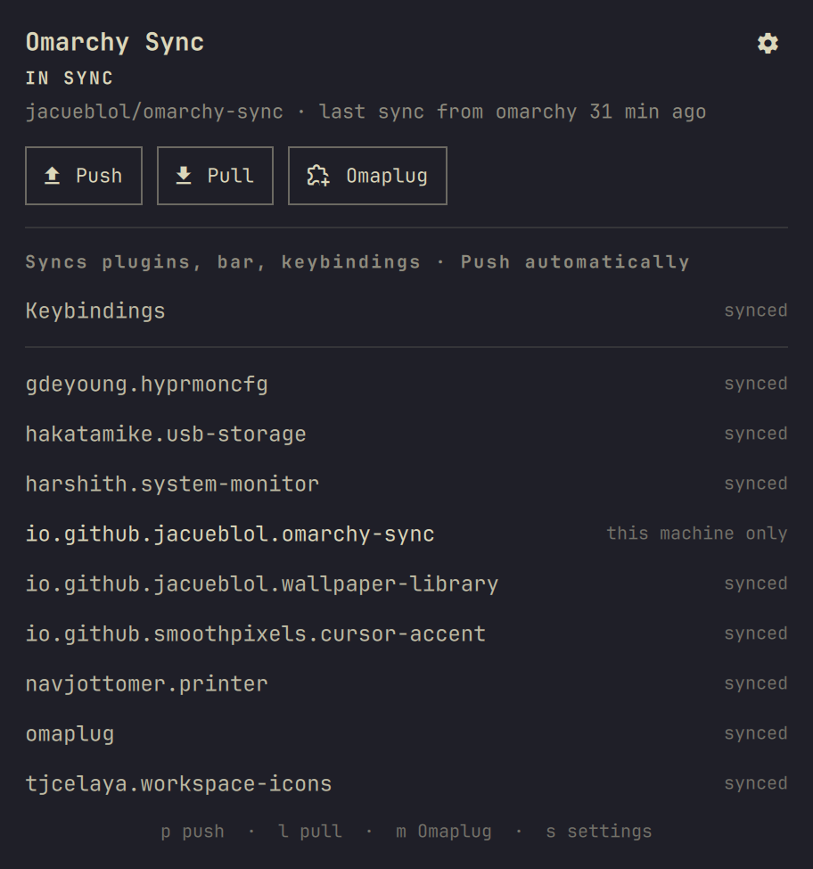

# Omarchy Sync

Keep your Omarchy plugins, bar layout, keybindings, mouse settings, theme,
and wallpaper the same on every machine. Omarchy Sync records which plugins you have installed,
how your bar is arranged, and the config files you choose in a private git
repo you own. Your other machines read that repo and install, remove, and
arrange their plugins and update their config to match.

Omarchy Sync was called Plugin Sync before 2.0. To switch, install Omarchy
Sync, enter the same sync repo in its settings, then run
`omarchy plugin remove io.github.jacueblol.plugin-sync`. It picks up Plugin
Sync's local state, so it carries on from the last sync.

## Features

- **Plugins**: installs plugins another machine added, removes ones it
  removed, and syncs which plugins are enabled.
- **Bar**: widget order, bar position, and every widget's settings, such as
  the clock's 12- or 24-hour format.
- **Keybindings**: `~/.config/hypr/bindings.lua`.
- **Mouse and keyboard input**: `~/.config/hypr/input.lua` (sensitivity,
  acceleration, natural scrolling, keyboard layout).
- **Any other config file** under `~/.config` you list, such as
  `hypr/looknfeel.lua` or `starship.toml`.
- **Other shell settings** (optional): idle and lock timers and the rest of
  `shell.json`.
- **Theme and wallpaper** (optional): the current theme, themes you
  installed or made yourself, and the current wallpaper.
- **Wallpaper Library categories** (optional): with the
  [Wallpaper Library](https://github.com/jacueblol/omarchy-wallpaper-library)
  plugin, other machines download the categories you have.
- **Per-machine choices**: each machine picks what it syncs, which plugins
  stay machine-specific, and when it syncs. Pushing only replaces the parts a
  machine syncs.
- **Per-machine overrides**: `hypr/bindings.local.lua` and
  `hypr/input.local.lua` are never synced and load after the shared files.
- **Confirmed pulls**: see every plugin to install or remove, every setting to
  replace, and every file to change (with lines added and removed) before
  anything happens.
- **Safe file updates**: replaced files are backed up, and if Hyprland
  reports new config errors after a pull, every file is put back.
- **No accidental undo**: if a pull can't apply something, automatic pushes
  wait instead of sending this machine's old setup back over it.
- **Automatic sync**: Manual, push automatically, or push and pull
  automatically, with a choice of who wins when both machines changed.
- **Any git host**: a private GitHub repo created for you, or any git URL you
  can push to.

Each machine chooses what it syncs and when. Nothing changes on a machine
without your say-so: by default a machine only shares its own changes, and
applying changes from elsewhere is a **Pull** you confirm after seeing exactly
what it will do.

It works alongside [Wallpaper Library](https://github.com/jacueblol/omarchy-wallpaper-library):
wallpapers picked from it sync by name and are downloaded on the other
machine, instead of being copied into your sync repo.

It works alongside [Omaplug](https://github.com/fross100/omaplug): install,
update, or remove plugins and arrange the bar in Omaplug as usual, and Omarchy
Sync notices and shares the change. After a pull, Omaplug's list refreshes on
its own.



## Install

```sh
omarchy plugin add https://github.com/jacueblol/omarchy-sync-plugin --enable
```

### Set up the sync repo

Open the panel and click **Set up sync repo**. A terminal opens and, after
asking, creates a private `<your-github-user>/omarchy-sync` repo with the
GitHub CLI (`gh`), then pushes this machine's plugins, bar layout, and
keybindings to it.

To use another name or host, enter it under **Settings › Sync repo** first
(`owner/name` on GitHub, or any git URL you can push to, such as
`git@gitlab.com:you/omarchy-sync.git` or a path to a bare repo on a shared
drive). `gh` is only needed to create a GitHub repo for you.

### Add another machine

Install the plugin there, open the panel, and click **Set up sync repo**. It
finds the existing repo and connects to it instead of creating one. Review
**Settings** on that machine (for example, turn on **Mouse and keyboard
input** if it should match), then click **Pull**: the panel lists the plugins
it will install or remove, the settings it will replace, and the files it
will change, and nothing happens until you confirm.

## Usage

The bar icon spins while syncing and shows a dot when there is something to
push or pull.

| State | Meaning |
|---|---|
| In sync | Everything this machine syncs matches the repo |
| Changes to push | You changed plugins, the bar, or a synced file here |
| Changes to pull | Another machine shared changes |
| Both changed | Each side changed since this machine last synced. Choose **Push** or **Pull** |
| First sync here | This machine has never synced. Usually **Pull** |
| Last pull didn't finish | A pull couldn't apply something, such as a theme whose git repo is gone. The panel lists what. Automatic pushes wait until a pull succeeds, so this machine doesn't undo the other machine's changes. **Pull** to retry, or **Push** to keep this machine's setup instead. **Push and pull automatically** retries on its own and only notifies again if something new fails |

The panel lists each synced file (**synced**, **changed here**, **to pull**,
or **changed on both**), then each plugin (**synced**, **only here**, **to
install**, **this machine only**, or **not synced**).

| Action | Mouse | Keyboard |
|---|---|---|
| Share this machine's changes | **Push** | `p` |
| Apply changes from other machines | **Pull** (confirm) | `l` |
| Open Omaplug | **Omaplug** | `m` |
| Settings | gear icon | `s` |
| Back / close | click outside | `Esc` |

From a terminal or a keybinding:

```sh
omarchy-shell shell toggle io.github.jacueblol.omarchy-sync
omarchy-shell io.github.jacueblol.omarchy-sync settings
omarchy-shell io.github.jacueblol.omarchy-sync sync    # does what the Automatic sync setting allows
omarchy-shell io.github.jacueblol.omarchy-sync push
omarchy-shell io.github.jacueblol.omarchy-sync pull    # applies without the confirmation step
```

The helper script can also be run directly; `status` prints JSON:

```sh
~/.config/omarchy/plugins/io.github.jacueblol.omarchy-sync/omarchy-sync status|push|pull|auto|init [repo]
```

## Configure

Open the panel and click the gear (or press `s`). Settings are saved in this
machine's `~/.config/omarchy/shell.json` and are never synced, so each machine
can sync different things.

| Setting | Default | What it does |
|---|---|---|
| Installed plugins | on | Install plugins another machine added, and sync which plugins are enabled |
| Remove plugins removed elsewhere | on | Let a pull remove plugins the repo no longer lists. Plugins with uncommitted local changes are never removed |
| Bar layout | on | Widget order, bar position, and widget settings |
| Other shell settings | off | Everything else in `shell.json`, such as idle and lock timers |
| Keybindings | on | `~/.config/hypr/bindings.lua` |
| Mouse and keyboard input | off | `~/.config/hypr/input.lua`: sensitivity, acceleration, scrolling, keyboard layout. Off by default because laptops and desktops usually want different values |
| Other files | none | Comma-separated paths under `~/.config`, such as `hypr/looknfeel.lua, starship.toml` |
| Theme and wallpaper | off | The current theme, user themes, and the current wallpaper. See the size note below |
| Wallpaper Library categories | off | Shown when Wallpaper Library is installed. Downloads the categories other machines have. Each can be tens to hundreds of MB |
| Notify after automatic pulls | on | Desktop notification when a pull ran on its own |
| Automatic sync | Push automatically | **Manual**: only shows the state. **Push automatically**: shares this machine's changes, but other machines' changes wait for your Pull. **Push and pull automatically**: also applies other machines' changes without asking |
| When both machines changed | Ask | **Ask**, **Keep this machine** (push), or **Use the repo** (pull, only in Push and pull mode) |
| Check other machines every | 15 minutes | Local changes are noticed within a minute |
| Machine-specific plugins | none | Plugins that stay on this machine only: never installed, removed, or moved by a sync, and their bar position is kept |
| Sync repo | empty | `owner/name` on GitHub, or any git URL |

Pushing only replaces the parts this machine syncs, so a laptop that doesn't
sync shell settings never overwrites the desktop's.

The same settings can be scripted:

```sh
omarchy bar set io.github.jacueblol.omarchy-sync mode "Push and pull automatically"
omarchy bar set io.github.jacueblol.omarchy-sync syncShellSettings true --json
omarchy bar set io.github.jacueblol.omarchy-sync localOnly "omarchy.battery,acme.vpn"
omarchy bar set io.github.jacueblol.omarchy-sync syncInput true --json
omarchy bar set io.github.jacueblol.omarchy-sync extraFiles "hypr/looknfeel.lua,starship.toml"
omarchy bar move io.github.jacueblol.omarchy-sync --section right
```

## What gets synced

- **plugins.json**: the id and git URL of every git-managed plugin in
  `~/.config/omarchy/plugins/`. A pull installs missing ones with
  `omarchy plugin add` and removes dropped ones with `omarchy plugin remove`.
  Plugins without a git origin (hand-made or symlinked development plugins)
  are left alone and listed as not synced.
- **shell.json**: the parts each machine chooses to sync. A pull backs up the
  old file to `shell.json.bak.<timestamp>` before changing it. Widget
  settings, such as the clock's 12- or 24-hour format, sync with the bar
  layout.
- **files/**: keybindings, input settings, and any other files you list, as
  whole files. A pull backs up each file it replaces to
  `~/.local/state/omarchy-sync/backups/` (the 20 most recent pulls are kept).
  When a pull changes files under `hypr/`, it reloads Hyprland, and if that
  brings new config errors it puts every file back and stops before changing
  anything else. A sync never deletes a file: a machine without the file just
  doesn't share it.

### Theme and wallpaper

- **Theme**: a pull switches to the same theme with `omarchy theme set`.
- **Themes you installed** from git sync as their URL and are cloned on the
  other machine. **Themes you made** (folders in `~/.config/omarchy/themes/`
  without a git origin, including overlays on stock themes) are copied into
  the repo. A pull backs up a theme folder before replacing it.
- **Wallpaper**: wallpapers compare by content, so it doesn't matter where
  the image lives on each machine.
  - From the Wallpaper Library, and dharmx/walls has it: synced as its path;
    the other machine downloads only that image.
  - A stock Omarchy theme background: synced as its path.
  - Anything else: the image is copied into the repo and saved on the other
    machine in `~/.config/omarchy/wallpapers/synced/`. Only the current
    wallpaper's copy is kept in the repo.
- **Wallpaper Library categories**: categories other machines have are
  downloaded from dharmx/walls. Categories are never removed by a sync.

> **Size:** both options are off by default. Copied wallpapers and themes
> stay in the sync repo's git history after you change them, so a repo that
> syncs many custom wallpapers keeps growing. Downloading wallpaper
> categories can use several GB of disk on each machine.

### Settings for one machine only

Settings that should differ between machines, such as mouse sensitivity on a
laptop touchpad, go in `~/.config/hypr/input.local.lua` or
`~/.config/hypr/bindings.local.lua`. These are never synced. Load them by
ending the synced file with:

```lua
do local path = os.getenv("HOME") .. "/.config/hypr/input.local.lua"; local file = io.open(path, "r"); if file then file:close(); dofile(path) end end
```

Because that line is part of the synced file, your other machines get it
too. The local file loads last, so its settings win. To replace a synced
binding there, `hl.unbind` it first.

Plugin versions are not pinned. Each machine updates plugins on its own,
through Omaplug or `omarchy plugin update`.

## Security

Plugins run unsandboxed, a pull installs the plugins the sync repo lists, and
Hyprland runs synced `.lua` files as code. Keep the repo private, and only
give yourself write access. With the default settings, every pull shows what
it will change first and waits for you.

No sudo or pkexec is required. Omarchy Sync runs `git`, `jq`, `flock`,
`notify-send`, `gh` (only when creating the repo during setup), `hyprctl`,
`curl` and `omarchy theme` (for theme and wallpaper sync),
the `omarchy plugin` and `omarchy bar` commands, and `omarchy-shell` IPC. It
writes only to `~/.config/omarchy/shell.json` and the files you chose to sync
(on a pull, after a backup), `~/.config/omarchy/themes/` and
`~/.config/omarchy/wallpapers/` (with theme and wallpaper sync on), the
Wallpaper Library folder (through its commands), `~/.config/omarchy/plugins/` (through `omarchy
plugin`), and its own state in `~/.local/state/omarchy-sync/`.

## Dependencies

`git`, `jq`, `flock` (util-linux), and `notify-send` (libnotify) ship with
Omarchy.

The GitHub CLI is optional. It is only needed to have setup create a GitHub
repo for you, and it lets git push to GitHub over HTTPS:

```sh
omarchy pkg add github-cli
gh auth login
```

Without it, create the repo yourself and enter its SSH URL under
**Settings › Sync repo**.

## Remove

```sh
omarchy plugin remove io.github.jacueblol.omarchy-sync
rm -rf ~/.local/state/omarchy-sync   # local copy of the sync repo and backups
```

Removing the plugin leaves your plugins, bar, and config files as they are. The sync repo
stays on GitHub; delete it there if you no longer want it.

## License

[MIT](LICENSE)
